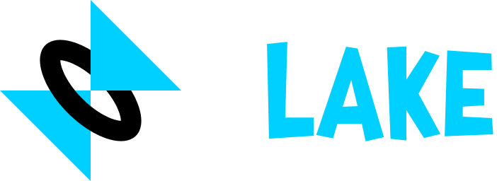

# Flake

<div align="center">



</div>

## An Immediate-Mode game framework

Flake is an **immediate-mode** game framework and graphics library built on WGPU + Winit. (Inspired by
macroquad). Designed to make creating apps and games easier. Supports all three main operating systems with known support for Windows.

## Getting Started

Add `flake-engine` to your `Cargo.toml` using the following command:

```asm
cargo add flake-engine
```

In your `main.rs` add the following code to create a window

```rust
use flake::prelude::*;

#[flake]
async fn main() {
    loop {
        end_frame!()
    }
}
```

The `#[flake]` proc-macro is a shorthand to get you started. Use `#[flake("my window")]` if you want a window with a
title.

---

## Drawing with Flake

Flake has a global state which means you don't have to get the context for drawing. Just write your drawing functions
directly:

```rust
loop {
    // If you don't clear the background it will be transparent
    clear_background(BLACK);
    
    draw_rectangle(50.0, 50.0, 200.0, 50.0, BLUE);
    draw_rectangle_lines(50.0, 50.0, 200.0, 50.0, 5.0, RED); // outline
    
    end_frame ! () // Remember to end the frame to avoid crashing
}
```

Flake includes many drawing functions, the most important being:

```rust
clear_background(color);

draw_text(text, x, y, font_size, font, color);
draw_rich_text(position, size, color, spans);

draw_rectangle(x, y, w, h, color);
draw_rectangle_lines(x, y, w, h, thickness, color);

draw_circle(x, y, radius, color);
draw_circle_lines(x, y, radius, thickness, color);

draw_texture(texture, x, y, w, h, color);

draw_arrow(x1, y1, x2, y2, thickness, head_size, color);
draw_line(x1, y1, x2, y2, thickness, color);
draw_poly_line(points, thickness, color, closed);
draw_poly_line_rounded(points, thickness, color, closed);

draw_triangle(x1, y1, x2, y2, x3, y3, color);
draw_triangle_lines(x1, y1, x2, y2, x3, y3, thickness, color);
draw_polygon(points, color);
draw_polygon_concave(points, color);
```

---

## Window Methods

Flake has many window methods:

```rust
get_window();
focus_window();

set_window_x(i32);
set_window_y(i32);
window_position() -> (f32, f32);
window_position_vec2() -> Vector2;
set_window_position(i32, i32);

window_width() -> f32;
window_height() -> f32;
window_size() -> Vector2;
set_window_width(u32);
set_window_height(u32);
set_window_size(u32, u32);

set_window_resizable(bool);
set_window_title( & str);
set_window_passthrough(passthrough); // whether you can click on the window
set_window_level(level); // WindowLevel::AlwaysOnTop
set_window_enabled_buttons(buttons); // WindowButtons::MAXIMIZE
set_skip_taskbar(bool);
set_window_transparent(bool); // may not work
set_window_decorations(bool);
set_window_visible(bool);
set_window_icon(path);
set_window_icon_bytes( & [u8]);

// Frames Per Second
get_fps() -> f32;
get_frames() -> usize;
get_frame_time() -> f32; // deltaTime
set_fps_capped(bool); // lets you uncap your FPS
set_target_fps(usize);
```

---

## Input in Flake

Flake supports mouse and keyboard inputs as of now. Controller support may be added in the future.

### Mouse Methods:

```rust
mouse_position() -> (f32, f32);
mouse_position_vec2() -> Vector2;
mouse_screen_position() -> (f32, f32);
mouse_screen_position_vec2() -> Vector2;

mouse_wheel() -> Vector2;
is_mouse_button_down(MouseButton) -> bool; // held
is_mouse_button_pressed(MouseButton) -> bool; // clicked this frame
is_mouse_button_released(MouseButton) -> bool; // released this frame
```

### Keyboard Methods

```rust
is_key_down(KeyCode) -> bool; // held
is_key_pressed(KeyCode) -> bool; // held
is_key_released(KeyCode) -> bool; // held

// Returns -1 if left is held and 1 if right is held and 0 if both/none;
get_axis(left: KeyCode, right: KeyCode) -> f32;

// Returns a Vector2, similar to get_axis() but for 2 axes
get_vector(left, right, up, down) -> Vector2;
```

---

## Text in Flake

By default, Flake is bundled with **JetBrains Mono** 💖. Text also supports using newlines like `\n`.

```rs
draw_text(text: &str, x: f32, y: f32, font_size: f32, font: Option<Font>, color: Color);
```

### Loading Fonts

Load a font using the following:

```rust
let my_font = load_font_from_path("Arial.ttf");
// or
let my_font = load_font_from_bytes( & [u8]);
```

Please do **NOT** load fonts inside the `loop {}` to avoid lag. Fonts are expensive. They should be loaded before the
loop;

You can use a font like this:

```rust
draw_text("This is using a Font", 20.0, 20.0, 16.0, Some( & my_font) RED);
```

**Note:** Fonts can be `clone()`'d without any overhead.

### RichText

RichText is a section of multiple `Span`s of text which have their own properties (Text, Color, Font, Size). Useful for
writing text with formatting or for dialog in games. It takes in an iterable of `Span`s to avoid allocation.

```rust
draw_richtext(vec2(10.0, 10.0), 16.0, WHITE, & [
    span("Hello,\n    my name is "),
    span("John Doe")
        .with_font(Some( & my_font))
        .with_size(30.0)
        .with_color(RED)
]);
```

## Measuring Text

If you need to get the width and height of some text before drawing (Such as for centering/aligning text) you can use
the
`measure_text()` function.

```rust
measure_text(text: & str, font_size: f32, font: Option<Font>) -> Vector2;
```

Where `.x` and `.y` give the width and height respectively.

---

## Textures and Images

Flake supports loading, and writing to Images and drawing textures. Textures support `FilterType::Nearest` for pixelated
and `FilterType::Linear` for smooth images. (default = Linear)

### Example

```rust
// Before the `loop {}`
let my_texture = load_texture("src/Cupcake.png");
```

```rust
// Inside `loop {}`
draw_texture(my_texture, 50.0, 50.0, 100.0, 100.0, WHITE);
```

### Loading a Texture

You can load a texture by using these methods:

```rust
load_texture(path);
load_texture_with_filter_type(path, FilterType);
// or
load_texture_from_bytes(&[u8]);
load_texture_from_bytes_with_filter_type(&[u8], FilterType);
// or
load_texture_from_data(width, height, &[f32]) // R, G, B, A pixel data from 0-1
load_texture_from_data_with_filter_type(width, height, &[f32], FilterType);
// or
load_texture_from_image(&Image);
```

### Updating a Texture

You can update the data in a `Texture` using an `Image` by using the following:

```rust
update_texture(my_texture, &Image);
// or
my_texture.update(&Image);
```

### Drawing a Texture

```rust
draw_texture(my_texture, x, y, w, h, color); // tint the texture using a Color
draw_texture_ex(my_texture, x, y, params);   // DrawTextureParams
```

Extra texture drawing parameters, called `DrawTextureParams` allow you to draw
a part of the texture rather than the entire texture and even rotate or flip it.

```rust
pub struct DrawTextureParams {
    pub dest_size: Option<Vector2>,
    pub source: Option<Rect>, // x, y, w, h in pixels
    pub rotation: f32,        // radians
    pub pivot: Option<Vector2>, // world coords, default = center
    pub flip_x: bool,
    pub flip_y: bool,
    pub color: Color,
}
```

---

## RenderTarget

A render target is a separate surface on which you can draw.
Useful if you want to make a scrolling surface or for clipping some objects.

Instead of drawing to the screen, you can create a camera that uses the render target
instead, then switch it back to the default screen camera afterward.

```rust
// Create a render target using a width and height
let target = render_target(100, 100, FilterType::Linear);
let cam = Camera2D {
    render_target: Some(target.clone()),
    ..Default::default()
};
```

It is advised that you create the target and the camera before the `loop {}`
since creating targets infinitely at runtime will clog memory and speed.

```rust
// Draw the RenderTarget's texture at (0, 0) with size (100, 100)
draw_texture(target.texture, 0.0, 0.0, 100.0, 100.0, WHITE);
```